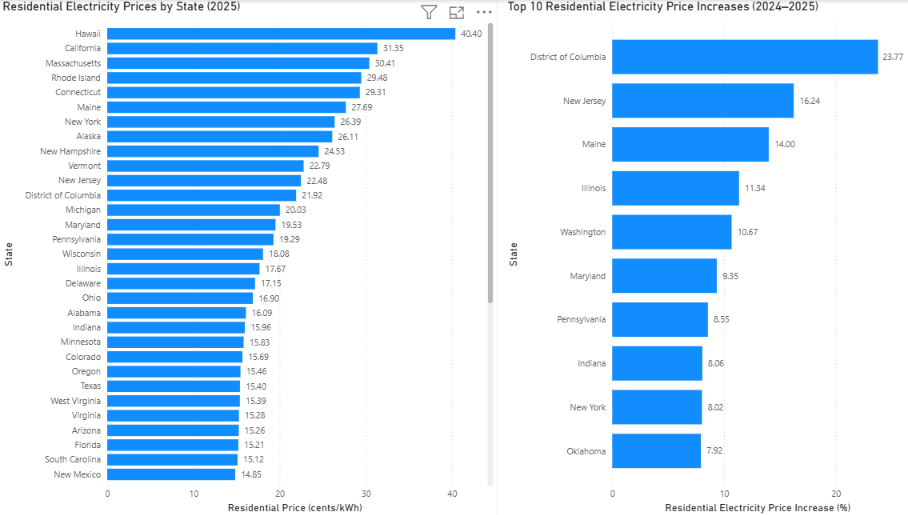
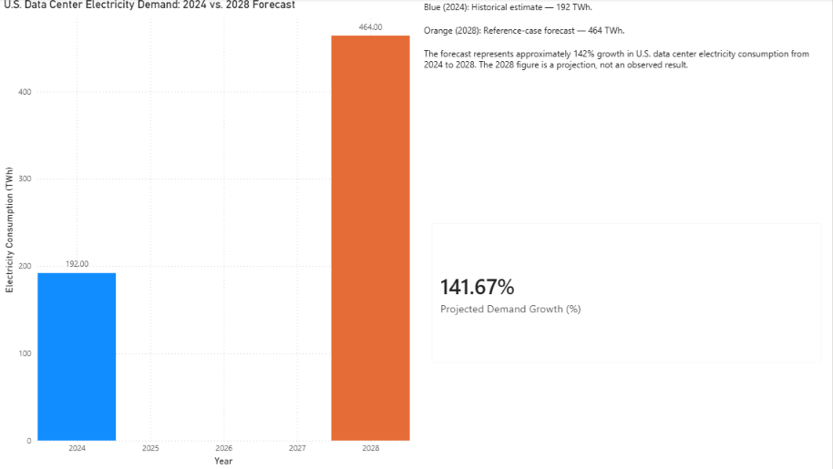
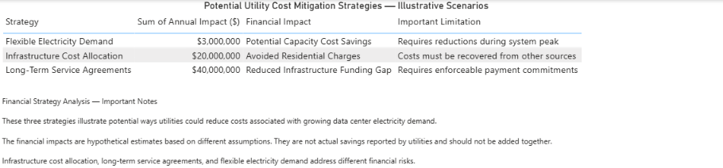
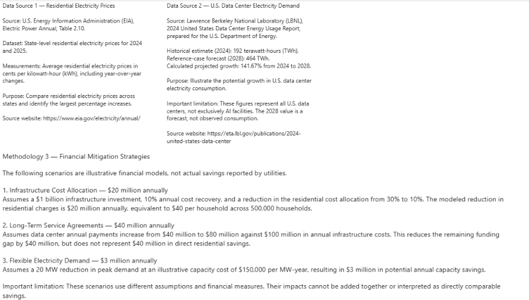

# The Cost of AI: U.S. Data Center Growth and Utility Customer Costs

## Project Overview

This data analytics project examines the growth of U.S. data center electricity demand and its potential implications for residential utility customers.

Using Python, Jupyter Notebook, and Power BI, the project analyzes residential electricity prices, compares historical and projected data center electricity consumption, and evaluates hypothetical financial strategies that utilities could use to reduce potential customer cost impacts.

The project focuses on three questions:

1. How do residential electricity prices vary across U.S. states?
2. How much is U.S. data center electricity demand projected to grow between 2024 and 2028?
3. What financial strategies could help utilities manage infrastructure costs while protecting residential customers?

**Important:** The project does not establish that data center growth caused observed residential electricity price increases. Financial scenarios are illustrative, and projected demand includes all U.S. data centers, not exclusively AI facilities.

## Tools and Technologies

- **Python:** Data cleaning, exploratory data analysis (EDA), calculations, and data preparation.
- **Pandas:** Data manipulation, filtering, aggregation, and CSV processing.
- **Jupyter Notebook:** Documenting the analysis, calculations, and findings.
- **Power BI Desktop:** Interactive dashboard development, data visualization, and DAX calculations.
- **Excel / CSV:** Working with electricity price datasets and processed data.
- **Visual Studio Code:** Python development and project organization.
- **GitHub:** Version control and portfolio presentation.

## Data Sources

- **U.S. Energy Information Administration (EIA):** *Electric Power Annual*, Table 2.10 — residential electricity prices by state for 2024 and 2025.
- **Lawrence Berkeley National Laboratory (LBNL):** *2024 United States Data Center Energy Usage Report* — historical electricity demand estimates and projected demand scenarios.
- **Illustrative Financial Models:** Three hypothetical utility cost mitigation scenarios developed for this project.

See the Power BI **Data Sources & Methodology** page for assumptions and limitations.

## Key Findings

### 1. Residential Electricity Prices (2025)

According to the U.S. Energy Information Administration (EIA), the states with the highest average residential electricity prices in 2025 included:

- **Hawaii:** 40.40 cents/kWh
- **California:** 31.35 cents/kWh
- **Massachusetts:** 30.41 cents/kWh

The largest percentage increases in residential electricity prices from 2024 to 2025 included:

- **District of Columbia:** 23.77%
- **New Jersey:** 16.24%
- **Maine:** 14.00%

These results demonstrate significant geographic differences in residential electricity costs.

### 2. U.S. Data Center Electricity Demand

- **2024 historical estimate:** 192 terawatt-hours (TWh)
- **2028 reference-case forecast:** 464 TWh
- **Projected increase:** 141.67%

The forecast suggests substantial growth in U.S. data center electricity consumption. These figures cover all data centers, not exclusively AI facilities.

### 3. Hypothetical Financial Mitigation Strategies

Three illustrative scenarios were developed to explore potential utility cost management approaches:

- **Infrastructure Cost Allocation:** $20 million in modeled annual residential cost reduction.
- **Long-Term Service Agreements:** $40 million reduction in the modeled annual infrastructure funding gap.
- **Flexible Electricity Demand:** $3 million in potential annual capacity savings.

These figures are based on different hypothetical assumptions and cannot be added together or interpreted as directly comparable savings.

### Key Takeaway

Data center electricity demand is projected to grow substantially, creating potential challenges for electricity infrastructure planning and cost allocation. Utilities may be able to manage these challenges through appropriate cost allocation, long-term agreements, and flexible demand arrangements.

**Limitation:** This analysis does not demonstrate a causal relationship between data center growth and residential electricity price increases.

## Power BI Dashboard

The interactive Power BI dashboard contains four pages covering residential electricity prices, data center electricity demand, financial mitigation strategies, and supporting methodology.

### 1. Residential Electricity Prices

### 2. Data Center Electricity Demand

### 3. Financial Strategies

### 4. Data Sources and Methodology

